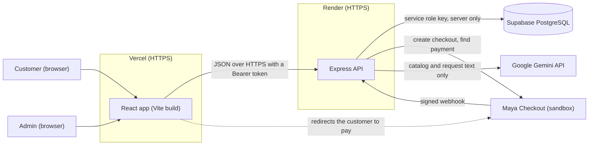
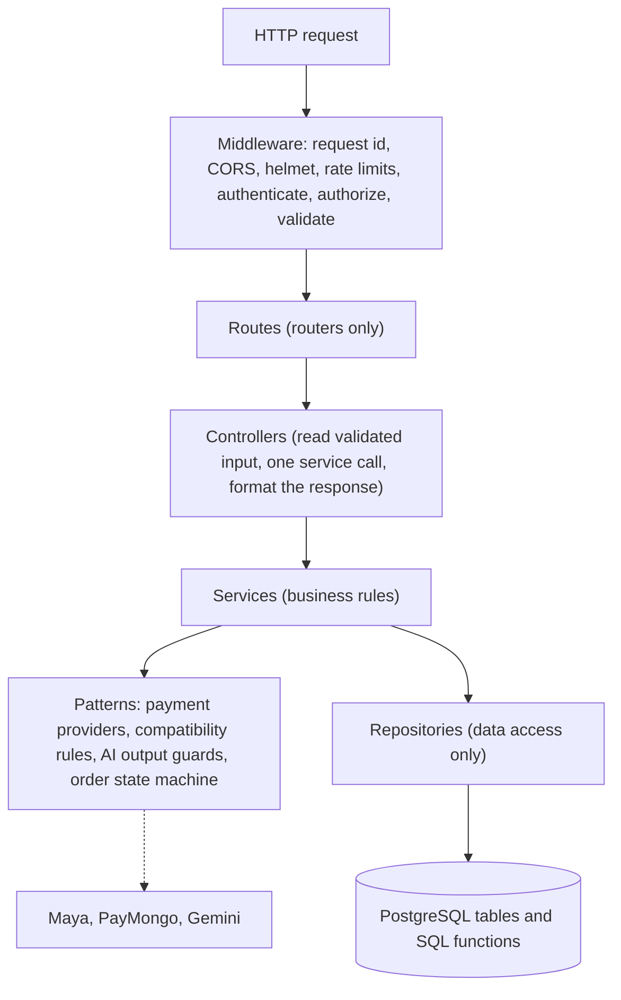
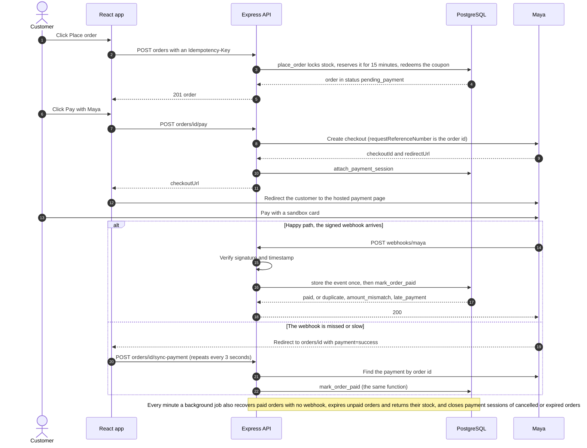
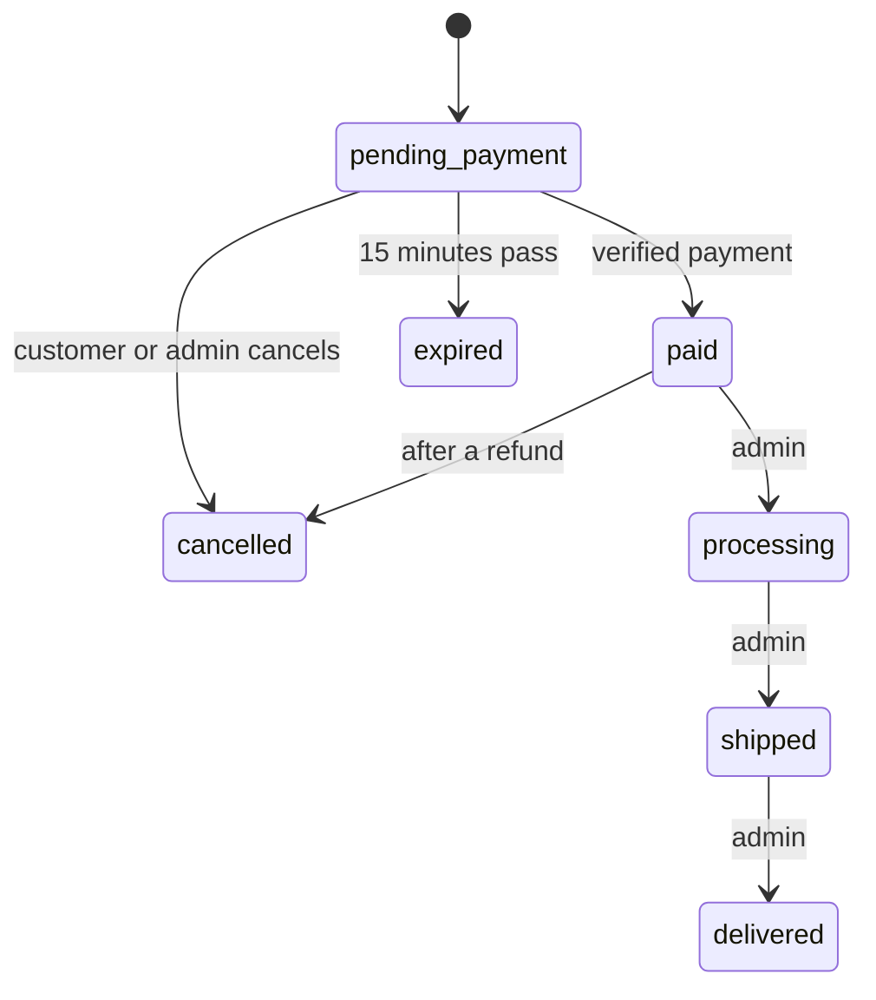

# System architecture

## 1. Context

Trust boundaries: the browser is untrusted (prices, roles and quantities are always re-checked on the server). The database key and the AI key exist only on the server. Maya's webhook is untrusted until its signature is verified.

## 2. Layers of the backend

Rules that must not be split up (stock reservation, coupon redemption, marking an order paid) live in SQL functions, so each runs as one database transaction.

## 3. Checkout sequence, including the webhook and the missed-webhook paths

## 4. Order lifecycle

"paid" and "expired" are set only by the system. A payment that arrives for a cancelled or expired order is never marked paid: the order is flagged for a refund.

## 5. Background work
`backend/server.js` runs one sweep every minute: recover paid orders whose webhook never arrived, expire stale unpaid orders (returning stock and coupons), and close unused payment sessions. The database functions lock rows, so running the sweep on two server instances is safe.

## 6. Error format
Every failure uses `{ success: false, error: { code, message, details? }, requestId }`. Stack traces, SQL and provider messages go to the server log only.