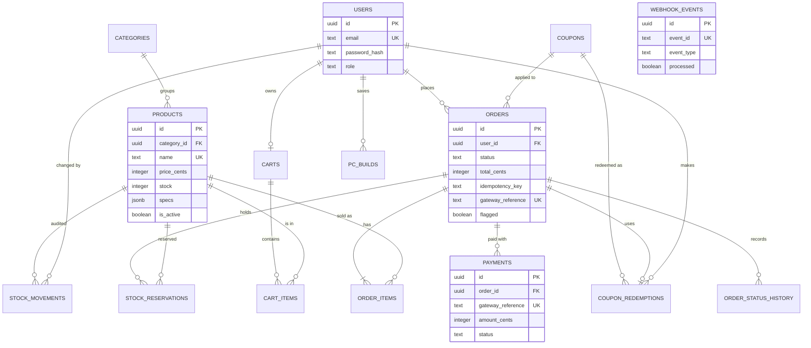

# Database design

PostgreSQL on Supabase. Money is stored as whole centavos (`150000` = PHP 1,500.00). The backend uses the service role key; row-level security is on for every table with no public policies, so the public key can read nothing.

## Entity relationship diagram

`WEBHOOK_EVENTS` has no foreign key on purpose: an event is stored before it is matched to an order, and its unique `event_id` is what rejects a replay.

## Tables
| Table | Purpose | Key constraints |
|---|---|---|
| `users` | Accounts | `email` unique; `role` is customer or admin; name 2 to 80 characters |
| `categories` | Product groups | `name` and `slug` unique |
| `products` | Catalog, with `specs` JSON read by the compatibility rules | `name` unique; `price_cents >= 0`; `stock >= 0`; category restricted on delete |
| `carts`, `cart_items` | Server-side cart | one cart per user; one row per (cart, product); quantity 1 to 99 |
| `coupons` | Discounts | `code` unique; type percentage or fixed; `value > 0`; per-customer limit at least 1 |
| `orders` | Orders and money totals | status limited to seven values; unique (`user_id`, `idempotency_key`); unique `gateway_reference` |
| `order_items` | Price and name snapshots | `product_id` restricted on delete, so a sold product cannot be deleted |
| `order_status_history` | Who moved an order, when, and why | cascades with the order |
| `coupon_redemptions` | One row per redeemed coupon | `order_id` unique |
| `stock_movements` | Audit trail of every stock change | previous and new stock, reason, actor |
| `stock_reservations` | Stock held for an unpaid order | status active, consumed or released |
| `payments` | One row per payment session | `gateway_reference` unique |
| `webhook_events` | Every verified payment event once | `event_id` unique |
| `pc_builds` | Saved builds | `share_code` unique; `part_ids` is a list of product ids |

Snapshots in `order_items` (name and unit price) are deliberate denormalization: later price changes must never alter an old order.

## Relationships and delete rules
- Deleting a user removes their cart and saved builds; orders are kept (no cascade).
- Deleting an order removes its items, history, reservations, payments and coupon redemption.
- A product that appears in an order cannot be deleted (`order_items.product_id` restricts). It is deactivated instead.

## Indexes
`idx_products_category`, `idx_products_active_created` (catalog listing), `idx_products_price` (price filter and sort), `idx_orders_user` (a customer's orders, newest first), `idx_orders_status` (admin filters), `idx_pc_builds_user`. Unique constraints create their own indexes.

## SQL functions (one transaction each)
| Function | What it guarantees |
|---|---|
| `shipping_for` | Flat PHP 150, free from PHP 5,000 |
| `apply_coupon` | Validates a coupon under a row lock; percentage rounds down |
| `quote_cart` | Prices the cart from the database |
| `place_order` | Creates the order, snapshots prices, reserves stock, redeems the coupon, clears the cart; idempotent per key |
| `release_order` | Cancels or expires an unpaid order and returns stock and coupon |
| `expire_stale_orders` | Expires every unpaid order whose window ended |
| `adjust_stock` | Changes stock never below zero and records the movement |
| `transition_order` | Moves an order only from the status the caller saw |
| `dashboard_stats` | Admin summary numbers |
| `attach_payment_session` | Stores a payment session, reusing an existing pending one |
| `mark_order_paid` | The only way an order becomes paid; checks amount and currency, flags late payments |

## Setup, seed and reset
Run `backend/sql/001` to `005` in the Supabase SQL editor, in order. Then `npm run seed` (idempotent: 6 categories, 24 products, 3 users, 3 coupons). `npm run reset` empties every table (development only; it refuses to run in production).